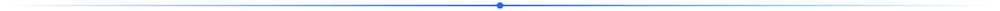
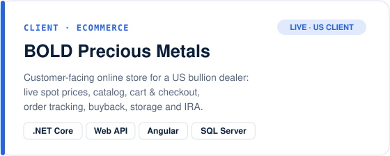
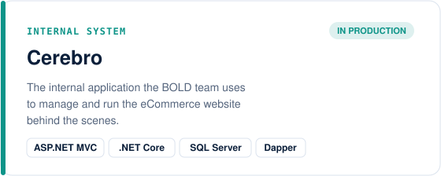
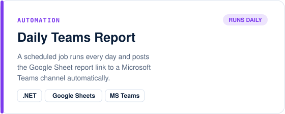
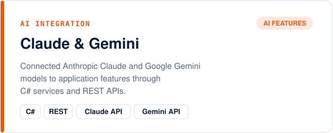
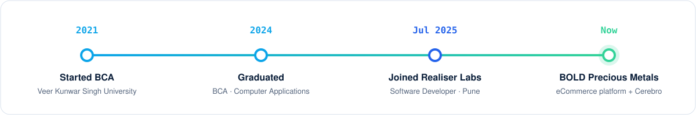

<a href="https://varshakumari-dev.github.io">
<picture>
<source media="(prefers-color-scheme: dark)" srcset="assets/header-dark.svg">

</picture>
</a>

### 👩‍💻 About me

I'm a **.NET Full Stack Developer** with **1.6 years** of professional experience and a **BCA** from Veer Kunwar Singh University.
At **Realiser Labs Pvt Ltd** I work for the US client **BOLD Precious Metals**, on its **eCommerce platform** and on **Cerebro**,
the internal system the team uses to run the website. I own features end to end: development, unit testing, bug fixing and
deployment to testing servers, using **.NET Core**, **ASP.NET MVC**, **Web API**, **Angular** and **SQL Server**.

- 🛒 Building and maintaining a live US eCommerce store for gold, silver and platinum bullion
- 🧠 Running internal operations through Cerebro, the website management system
- 🤖 Added AI features with the **Claude** and **Gemini** APIs
- ⏰ Automated a daily Google Sheet report that posts itself to **Microsoft Teams**
- ✨ I care about clean, maintainable code and fast, reliable applications

<picture><source media="(prefers-color-scheme: dark)" srcset="assets/divider-dark.svg"></picture>

### 🚀 What I work on

<table>
<tr>
<td width="50%"><a href="https://www.boldpreciousmetals.com/"><picture><source media="(prefers-color-scheme: dark)" srcset="assets/project-bold-dark.svg"></picture></a></td>
<td width="50%"><picture><source media="(prefers-color-scheme: dark)" srcset="assets/project-cerebro-dark.svg"></picture></td>
</tr>
<tr>
<td width="50%"><picture><source media="(prefers-color-scheme: dark)" srcset="assets/project-teams-dark.svg"></picture></td>
<td width="50%"><picture><source media="(prefers-color-scheme: dark)" srcset="assets/project-ai-dark.svg"></picture></td>
</tr>
</table>

> These are client and company projects, so the source code is private. The portfolio site and this profile are public.

<picture><source media="(prefers-color-scheme: dark)" srcset="assets/divider-dark.svg"></picture>

### 🧰 Tech stack

| | |
|---|---|
| **Backend** |      |
| **Frontend** |     |
| **Database** |      |
| **AI & integrations** |     |
| **Tools & practices** |     |

<picture><source media="(prefers-color-scheme: dark)" srcset="assets/divider-dark.svg"></picture>

### 🛤️ My journey

<picture>
<source media="(prefers-color-scheme: dark)" srcset="assets/timeline-dark.svg">

</picture>

<b>What I do day to day</b>

- **Realiser Labs Pvt Ltd** (Jul 2025 – present), Software Developer, client **BOLD Precious Metals** (USA):
  end-to-end feature development on the eCommerce platform and Cerebro with .NET Core, ASP.NET MVC, Web API, C# and Angular;
  SQL Server queries and stored procedures with Entity Framework, Dapper and ADO.NET; unit testing, bug fixing and deployment
  to testing servers; AI features with Claude and Gemini; a daily Google Sheet report posted to Microsoft Teams.
- **Bachelor of Computer Applications (BCA)**, Veer Kunwar Singh University (2021 – 2024).

Looking for a .NET full stack developer? Write to <a href="mailto:vkvarsh31@gmail.com">vkvarsh31@gmail.com</a> · <a href="https://varshakumari-dev.github.io/Varsha_Kumari_CV.pdf">Download my CV (PDF)</a>

